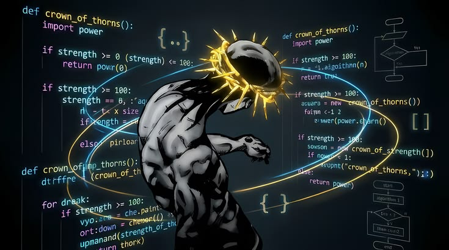

  

 

<table>
  <tr>
    <td width="30%" align="center">
      
    </td>
    <td width="70%">
      <h3 align="center">👋 Salut ! Moi c'est Benjamin</h3>
      

        Passionné par le <b>développement logiciel</b> et la <b>création de jeux vidéo</b> 🎮. 
        Curieux de nature et en apprentissage permanent, j'aime relever de nouveaux défis techniques et transformer mes idées en projets concrets. 
        Mon objectif est de perfectionner mes compétences jour après jour ! 🚀
      

    </td>
  </tr>
</table>

<h3 align="center">🛠️ Mes Langages & Technologies</h3>

  <!-- Icônes des technologies (C, C#, C++, HTML, CSS, JS, PHP, Unity, Godot, Git) -->
  

 

<!-- Optionnel : Une section pour montrer tes objectifs actuels -->
<h3 align="center">🎯 En ce moment...</h3>

  🕹️ J'apprends les fondamentaux du <b>Game Design</b> et du dev de jeux vidéo. 
  💡 Je renforce mes bases en <b>C / C#</b> et en <b>Développement Web</b>.

<!-- Optionnel : Statistiques GitHub -->

  

